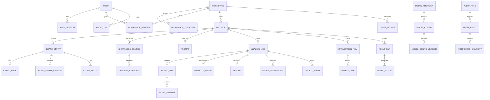

# 领域模型与状态机

## 1. 建模原则

- 所有租户业务对象可追溯到 `workspaceId`；跨租户外键必须在应用层和数据库约束策略中防护。
- 业务状态使用枚举，不用自由文本。
- 关键关系使用外键；关键可查询字段不塞入 JSON。
- `metadata` 只存供应商特有、低频、非关键扩展字段，并进行 schema 版本管理。
- 软删除仅用于确需恢复或审计的对象；账本、审计、模型调用不能物理覆盖。
- 所有表至少包含 `id`、`createdAt`；可变聚合含 `updatedAt` 和乐观锁版本。

## 2. 聚合关系



## 3. 核心实体约束

### Workspace / Member

- `User.emailNormalized` 全局唯一。P0 在管理登录成功时将 `geyaovip@163.com` 幂等地建立/绑定为平台 `super_admin`；管理权限不通过工作区角色推导。
- 所有工作区 API 和内部关联使用 UUIDv7 `workspaceId`。`Workspace.slug` 仅用于可选展示/易读路径，工作区内唯一性不取代权限校验。
- `WorkspaceMember(workspaceId, userId)` 唯一。
- 每个工作区至少一个 owner；最后一个 owner 不可移除或降级。

### Project

字段：`workspaceId, name, brandEntityId?, industryId?, defaultCountry, defaultLanguage, timezone, status, onboardingStatus, createdBy`。

- 项目必须先属于工作区，再创建其他业务对象。
- `brandEntityId` 在识别确认前可空，进入 `ready` 前必须存在。
- `timezone` 使用 IANA 名称；默认 `Asia/Shanghai`。
- `archived` 项目只读；owner/admin 可恢复到归档前的 `ready` 或 `active` 状态，恢复操作必须审计。已进入删除/法律保留流程的项目不能通过普通恢复接口处理。

统一状态机采用：

```text
draft → identifying → waiting_confirmation → ready → active → archived
```

分析是否运行由 AnalysisJob 表达，不在项目状态中加入 `analyzing`。首次生成可用报告后，Project 从 `ready` 进入 `active`。

### BrandEntity

核心字段按 PRD；别名拆为 `BrandAlias` 表，带规范化值、语言、来源与确认状态。核心字段变更创建 `BrandEntityVersion`，不会修改历史报告快照。

### StoreEntity

- `(brandEntityId, externalStoreCode)` 在 code 非空时唯一。
- 经纬度使用 Decimal/geography 类型，不用浮点字符串。
- 状态：`pending | active | temporarily_closed | permanently_closed | duplicate | needs_review`。
- 重复检测产生 `StoreMergeCandidate`；正式合并必须记录操作者、来源门店、目标门店和字段决策。

### KnowledgeSource / ContentSnapshot

- 状态：`discovered | confirmed | rejected | unavailable | outdated | needs_review`。
- URL 存规范化值，同时保留原始 URL；同一项目的规范化 URL 默认唯一。
- Snapshot 保存哈希、抽取正文、结构化字段、摘要、抓取结果和与前版差异；P0 大型原文可放云服务器私有文件目录并由数据库保存引用。
- `lastFetchedAt` 代表最近一次尝试，`lastSuccessfulFetchedAt` 代表最近成功抓取，两者都保留。
- 用户手动添加的公开 URL 在写入时归一化并确认；只有 `confirmed` 来源可入抓取队列。每次请求和每次重定向都重新解析 DNS，任一地址命中回环、私网、链路本地或云元数据网段即拒绝；同时限制重定向、超时、MIME 和解压后字节数。

### Prompt / PromptVersion

- 业务身份与版本内容分离：`Prompt` 保存当前状态，`PromptVersion` 保存 text、scope、语言、来源和版本号。
- 同一 Prompt 版本号唯一且只增不改；ModelRun 永远引用具体 `promptVersionId`。
- `normalizedText` 用于查重，不作为展示文本。
- 当前 `Prompt` 保存可编辑投影、优先级、启停与分组；每次内容或 Scope 修改在 Serializable 事务内追加 `PromptVersion`。删除是带审计的软删除，不会删除已有版本。
- `city/district/nearby/store` Scope 必须提供对应的真实地域或门店 ID；缺失时返回 `SCOPE_CONTEXT_REQUIRED`，不由生成器猜测。规则层同时拒绝强制推荐类诱导表达，并对归一化重复与高相似问题给出稳定错误。

### ModelProvider / ModelConfigVersion

- P0 只有一个 `ModelProvider(code=volcengine_ark)`，供应商级凭证与豆包/Kimi/GLM/DeepSeek 的模型配置分开。
- `ModelConfig` 保存 `modelFamily=doubao|kimi|glm|deepseek`、当前显示名和启停状态；`ModelConfigVersion` 冻结火山 `modelCode/endpointId`、API 模式、能力矩阵、内置联网参数、价格、并发、超时和探测时间。
- 每个 ModelRun 引用具体 `modelConfigVersionId`，运行后不随管理端同步新 Model ID 而改变。
- `ModelProviderCredential` 只保存 AES-256-GCM 密文、IV、认证标签、key version 和掩码提示；覆盖时退役旧版本，任何读接口都不返回明文。
- `ModelCallLog` 按 request ID 记录供应商/模型版本、Token、估算成本、联网开关/工具版本、耗时、错误分类和重试次数；只保存请求/响应哈希，不保存凭证。

### AnalysisJob / ModelRun

- 创建 Job 时冻结 Prompt 版本、模型配置快照、Scope、价格估算和评分版本候选。
- 每个逻辑 ModelRun 使用 `(analysisJobId, promptVersionId, modelConfigVersionId, scopeHash, sampleIndex)` 唯一；P0 `sampleIndex=0`，为后续重复采样保留扩展。供应商重试记录为 RunAttempt，不新建逻辑 ModelRun。
- ModelRun 保存最终地域快照、注入方式、`nativeWebSearchEnabled`、供应商搜索工具/版本和来源引用。模型无原生联网能力时，需联网的组合在估算阶段标记为 unsupported，不创建 Run。
- 请求原文、响应原文与解析产物分开保存；敏感内容按保留策略清理。

Job 状态：

```text
draft → queued → running → completed
                     ├→ partially_completed
                     ├→ failed
                     └→ cancelled
```

终态由计数确定：全部成功为 completed；成功大于 0 且仍有永久失败或用户取消为 partially_completed；成功为 0 且有失败为 failed；用户取消且无成功结果为 cancelled。取消另存发起人、时间和原因。

### EntityMention / Competitor

EntityMention 保留 `rawName`、推荐/顺位、情感与证据片段；归一化引用可以为空。`FactClaim` 独立保存事实文本、正确性标签、置信度与证据。低置信度产生 `EntityReviewIssue`。竞品分为自动候选与已确认实体，排除决定需要保存以防重复推荐。

### VisibilityScore

- 每个 AnalysisJob + scoreVersion 最多一个有效快照；重算创建新记录，不覆盖旧记录。
- `dimensionScores` 不能只用无约束 JSON；至少使用带 `dimensionCode, value, weight, sampleSize, confidence` 的子表或经过版本校验的结构。
- 同时保存模型、Scope、Prompt 分类的分项与输入样本摘要。

### Report

状态：`generating → ready → published → archived`，异常为 `failed`。`Report` 是稳定业务身份，`ReportVersion` 冻结 AnalysisJob、VisibilityScore、内容、样本限制与生成时间；发布后内容不可原地重写，修正只能生成新版本。`ReportViewEvent` 只记录最小查看埋点。

### OptimizationItem

状态：`todo → in_progress → waiting_review → completed → scheduled_retest → verified`，可转 `cancelled`。必须保存证据引用，复测使用 `RetestLink` 连接原任务、基线 Job 与复测 Job。

### UsageLedger

用量采用追加式账本：`workspaceId, userId?, projectId?, resourceType, quantity, unitCost, currency, source, relatedJobId?, idempotencyKey`。`idempotencyKey` 唯一，冲正使用反向记录而非改旧账。

`ModelRunResult.finishReason` 保存供应商的结束原因；`length` 表示回答受输出上限截断，原文可复核但不计入有效评分样本。

当前实现以 `quantityMicros` 表示 CNY 微元：grant/release/positive adjustment 为正，reservation/debit/negative adjustment 为负。预留在 Serializable 事务内检查净额并写入唯一幂等键；相同键的相同估算返回原记录，参数不同返回 409。

### AgentRun / AgentAction / AuditLog

- Run 保存触发者、OpenClaw 运行时版本、Token 预算、上下文快照、引用和状态。
- Action 保存 Skill/版本、规范化参数、风险、输出快照、错误和执行幂等键；P0 注册项只有只读和低风险单对象操作。
- `AdminTodo` 是 Agent 可创建的低风险待办，关联 AgentRun；模型输出本身不能新增 Action。
- 审计日志追加写，保存 actor、subject、action、target、before/after 摘要、requestId、IP/UA（适用时）。密钥和完整模型敏感内容不得进入审计。

### Notification / NotificationChannelConfig / NotificationDelivery

- `Notification` 按业务事件与用户幂等创建，保存类型、标题、正文、目标路径和已读时间；报告 ready 事件由 Worker 消费后为工作区成员创建站内通知。
- `NotificationChannelConfig` 的 Telegram Token/Chat ID 使用 AES-256-GCM 加密，仅返回掩码；只有白名单 `super_admin` 完成二次验证后可更新、启停或测试。
- `NotificationDelivery` 保存渠道、幂等键、状态、脱敏错误、供应商消息 ID 和尝试时间；测试消息限流为管理员每分钟最多 3 次。

### AlertEvent / Delivery（P1）

AlertEvent 状态：`open → acknowledged → resolved`，可 `ignored`。唯一去重键为 `ruleId + scopeType + scopeId + windowBucket`；恢复关闭原事件。每个渠道尝试独立记录 Delivery，渠道失败不回滚告警。P0 只实现通知渠道配置/测试所需的最小 Delivery，完整 AlertEvent 运行时进入 P1。

## 4. 数据保留

- 模型原始响应、网页正文快照、Agent 对话：180 天；
- 导入原文件和临时导出：30 天；
- 审计日志：至少 2 年；
- 已发布报告：项目存在期间保留，项目删除流程需执行法律保留检查；
- 备份和私有文件目录的生命周期必须与上述规则一致。

到期任务需可审计并删除正文/文件，必要的聚合统计应匿名化。用户导出、删除和法律保留优先于普通生命周期任务。

P0 使用 `LegalHold` 保存 workspace/project 范围、原因、创建/释放人和有效状态；创建与释放只允许完成二次验证的 `super_admin`，并记录高风险审计。`DataLifecycleRun` 以 UTC 小时窗口作为幂等键，保存尝试次数、5 分钟超时、失败/死信和分类计数。运行时将到期的模型响应正文与引用、网页快照正文/结构化内容/私有文件、Agent 问答与 Action 输入输出清空，同时保留哈希、Token、成本、状态和聚合事实；命中有效法律保留的 workspace/project 时跳过。文件先删除、数据库路径后清空，数据库更新失败时下一轮以文件不存在视为可重入成功。P0 没有导入原文件和临时导出产物，因此 30 天策略在相应能力启用时接入同一任务。
