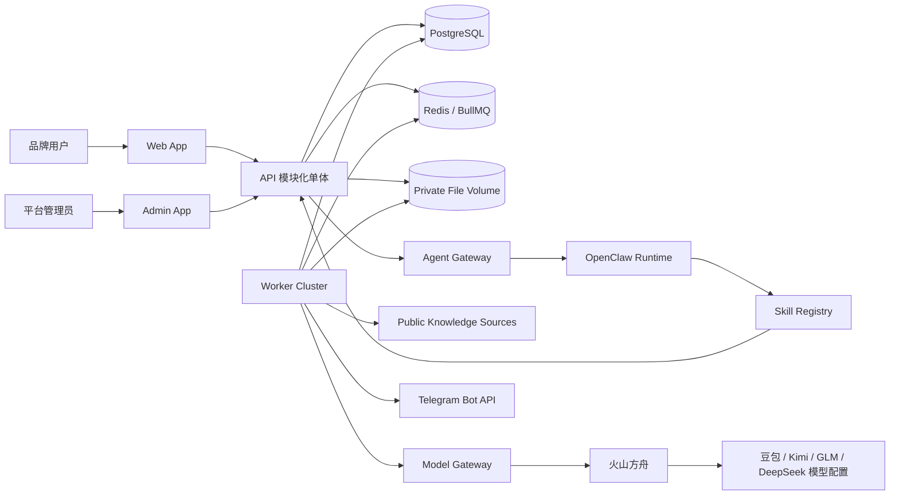

# 系统设计

## 1. 架构目标

首期采用 TypeScript Monorepo + 模块化单体 API + 独立 Worker 进程。这样保留清晰领域边界和水平扩展能力，同时避免过早承担微服务的一致性、部署和运维成本。

## 2. 建议技术基线

| 层            | 选择                                          | 说明                                                                                   |
| ------------- | --------------------------------------------- | -------------------------------------------------------------------------------------- |
| 用户端/管理端 | Vite + React + TypeScript                     | 两个 SPA，共享 UI、类型、React Router 和鉴权客户端                                     |
| API           | NestJS                                        | REST API、应用服务、权限与审计入口                                                     |
| Worker        | NestJS application context                    | 复用应用模块，不暴露公网 HTTP                                                          |
| 数据          | PostgreSQL + Prisma                           | 事务、迁移、关系约束                                                                   |
| 队列/缓存     | Redis + BullMQ                                | 长任务、重试、延迟任务、并发限制                                                       |
| 文件          | 云服务器私有文件目录                          | P0 在线报告以数据库为主，必要原始文件经 File Service 授权访问                          |
| Agent         | OpenClaw `v2026.7.1` 经 Agent Gateway         | 官方容器固定版本/摘要，仅调用注册 Skill                                                |
| 监控          | OpenTelemetry + Prometheus + Loki + Grafana   | 先在云服务器自托管，Trace/Metric/Log 使用统一关联 ID                                   |
| 前端部署      | Cloudflare Pages 静态 SPA                     | Web/Admin 使用 Vite 构建，不启用 Pages Functions/Workers                               |
| API/Worker    | 与其他项目共用的现有云服务器 + Docker Compose | 映川使用独立 Compose project、容器、网络、数据库账户和持久卷；只共用宿主资源和反向代理 |
| 文件与备份    | 云服务器持久卷/独立数据目录                   | 不使用 R2；本机恢复可用，整机灾难恢复待增加异地副本                                    |
| 源码与 CI/CD  | GitHub + GitHub Actions                       | PR 检查；Pages 使用 Git 集成，后端由 Actions 部署到云服务器                            |

## 3. 仓库目标结构

```text
apps/
  web/                 # 用户端
  admin/               # 管理端
  api/                 # NestJS HTTP 入口
  worker/              # BullMQ workers / scheduler
packages/
  database/            # Prisma schema、migration、seed
  auth/                # 身份、session、RBAC primitives
  shared-types/        # DTO、事件 envelope、错误码
  ui/                  # 共享设计系统
  model-gateway/       # Provider adapters、计价和限流
  agent-sdk/           # Skill contracts、风险与审批类型
  scoring/             # 纯函数评分、版本注册表
  notifications/       # 渠道适配器
  observability/       # logger、trace、metric
modules/
  workspaces/
  projects/
  brands/
  stores/
  knowledge-sources/
  prompts/
  analysis/
  parsing/
  reports/
  optimization/
  usage/
  admin/
  alerts/
  agents/
  notifications/
docs/
```

实际初始化时可让 `modules` 位于 `apps/api/src/modules`，但领域边界和依赖规则不变。

## 4. 系统上下文



## 5. 模块职责与边界

| 模块                 | 拥有的数据/职责                               | 不负责                                 |
| -------------------- | --------------------------------------------- | -------------------------------------- |
| Workspaces/Auth      | 成员、角色、邀请、租户上下文                  | 项目业务授权之外的业务规则             |
| Projects/Brands      | 项目生命周期、品牌事实、识别确认              | 外部抓取实现、评分                     |
| Knowledge Sources    | 来源、验证、快照、差异                        | Prompt 运行                            |
| Stores               | 门店候选、手工维护、去重和确认                | 自动高置信度正式合并；P0 不做 CSV 导入 |
| Prompts              | Prompt、分类、Scope、模板、版本               | 模型供应商调用                         |
| Analysis             | Job/Run 编排、状态、估算、取消                | Provider SDK 细节、评分公式            |
| Model Gateway        | Provider 适配、请求记录、价格、限流、故障分类 | 项目权限、报告                         |
| Parsing              | 实体提及、归一、竞品候选、解析置信度          | 最终人工确认                           |
| Scoring              | 版本化公式、置信度、分数快照                  | 修改历史报告                           |
| Reports              | 动态章节、在线发布和版本                      | 重算业务分数；P0 不做 PDF/公开分享     |
| Optimization         | 优化任务、证据、复测关联                      | 任意外部自动发布                       |
| Agents               | Run、Action、Skill、审批和审计关联            | 直连数据库或绕过应用服务               |
| Alerts/Notifications | 规则、事件、去重、渠道投递                    | 用 Agent 代替阈值判断                  |
| Usage                | 额度检查、用量账本、成本/补偿                 | 真实支付、订单或使用浮点数计算金额     |

## 6. 关键数据流

### 6.1 分析链路

```text
POST AnalysisJob
→ 事务内写 Job 与 Outbox
→ dispatcher 创建 model-run jobs
→ Model Gateway 调用供应商并记成本
→ parse jobs 生成 EntityMention
→ scoring 生成带版本分数
→ report job 生成在线报告
→ notification job 通知用户
```

创建任务与出队之间建议使用 Transactional Outbox，避免数据库已提交但消息未发送。每一阶段根据父 ID 和版本生成稳定幂等键。

### 6.2 品牌识别链路

用户输入先创建 Project 草稿；识别结果写入候选记录，不直接覆盖已确认 BrandEntity。确认操作在单个事务内形成实体、来源与门店候选，并记录确认人和原始证据。

## 7. 部署拓扑

```text
GitHub
├── Pull Request → Actions: lint / typecheck / test / static build / docs
└── main
    ├── Web/Admin `dist/` → Cloudflare Pages Git 集成
    └── API/Worker/OpenClaw image → 云服务器 Docker Compose

Cloudflare Pages
├── Web 静态站点
└── Admin 静态站点

共用云服务器
└── 映川独立 Compose project（`yingchuan`）
    ├── Caddy（独立容器，80/443 → 内网 API）
    ├── API
    ├── Worker
    ├── OpenClaw v2026.7.1（仅 Agent Gateway 可访问）
    ├── PostgreSQL（独立库/账户，不开放公网端口）
    ├── Redis（独立容器或 ACL/命名空间，不开放公网端口）
    └── 独立持久卷（私有文件、数据库备份、WAL、日志）
```

- Web/Admin 使用 Vite 构建 `dist/`，通过 Cloudflare Pages GitHub 集成自动发布。两个站点使用 SPA 回退路由，深层 URL 刷新必须回到 `index.html`；不使用 Pages Functions/Workers，业务能力全部来自云服务器 API。
- 前端通过 `VITE_API_BASE_URL` 访问 `https://api.chatway.chat/api/v1`。生产域名固定为 `https://app.chatway.chat`、`https://admin.chatway.chat`、`https://api.chatway.chat`；API CORS 仅允许前两个精确 Origin，并允许 credentialed requests。
- `*.pages.dev` 和 PR preview 不得连接生产 API。staging 使用 `staging-app.chatway.chat`、`staging-admin.chatway.chat`、`staging-api.chatway.chat` 与独立环境，不为动态 preview Origin 开放带 Cookie 的通配 CORS。
- `api.chatway.chat` 初期只使用 Cloudflare DNS 解析到云服务器（DNS only），TLS 由 Caddy/Let's Encrypt 在服务器终止；不使用 Cloudflare Worker/Pages Function 代理 API。
- 当前宿主没有共享 Caddy，因此映川以固定摘要的独立 Caddy 容器占用经盘点为空闲的 80/443；API 只通过内部 `backend` 网络接受 Caddy 转发，发布流程在容器内检查 ready 并从公网复核 HTTPS。PostgreSQL、Redis、OpenClaw 控制面不暴露公网，Cloudflare 不承载 API、队列、数据库、文件或 Agent。
- 映川与其他项目共用宿主机，但不共用应用容器、数据库 schema/账户、Redis 无隔离 keyspace、文件目录或备份目录。Compose 统一使用 `COMPOSE_PROJECT_NAME=yingchuan`，容器/卷/网络以 `yingchuan_` 前缀命名，避免端口和资源冲突。
- 开发前先盘点宿主 CPU/内存/磁盘/已占用端口，为 API、Worker、PostgreSQL、Redis、OpenClaw 和可观测组件设置明确 resource limit/reservation。资源不足时先保留核心 API/DB/Worker，将 Grafana/Loki/Prometheus 放入可选 Compose profile，不抢占其他项目资源。
- PostgreSQL 是事实源；Redis 丢失不得造成业务事实丢失。数据库每日全量并归档 WAL 到服务器独立备份目录，备份加密并定期恢复演练。
- 当前没有异机/异地备份目标：能应对逻辑误删和单容器故障，不能承诺服务器磁盘或整机损坏后的 RPO/RTO。后续可接服务器厂商快照、第二台服务器或其他对象存储，但不作为 P0 依赖。
- 私有文件通过 File Service 鉴权读取，宿主反向代理不直接暴露数据目录；按 D-023 执行生命周期删除。
- OpenClaw 使用官方 `ghcr.io/openclaw/openclaw:2026.7.1`，部署时进一步固定 digest；先在 staging 验证后人工升级，不使用浮动 `latest`。
- Worker 按队列分组并设置并发；`model-run` 与报告/文件任务隔离。Scheduler 使用数据库锁选主，任务自身仍须幂等。
- GitHub Actions 使用 environment protection 和最小权限凭证；生产部署保留上一镜像与数据库前向修复方案。

## 8. 配置与环境

环境至少划分 local、test、staging、production。前端只有公开构建变量，不得包含服务端密钥；后端生产密钥进入 GitHub Actions Secret 和服务器密钥文件，绝不进入镜像或 Pages 产物。配置启动时做 schema 校验，缺少关键配置立即失败。Provider、模型价格、并发和开关属于数据库配置并受审计，不应写死在代码。

P0 模型 Provider 统一为火山方舟 `volcengine_ark`，在同一账户下建立豆包、Kimi、GLM、DeepSeek 四类 ModelConfig。Model Gateway 只实现一个火山适配器，但每个具体 Model ID 独立维护能力、原生联网参数、价格、限流和健康状态。联网只使用火山对该 Model ID/API 模式官方暴露的内置能力；无能力时跳过，不使用外部检索。火山账户/区域故障是 P0 接受的单一外部故障域。

外部服务的已确认接入方式和官方资料入口见 `integration-baseline.md`。

## 9. 演进条件

仅当单个模块存在独立扩缩容、发布频率、合规隔离或故障域需求，并有观测数据支持时才拆服务。拆分前先稳定应用服务接口、领域事件与数据所有权。
